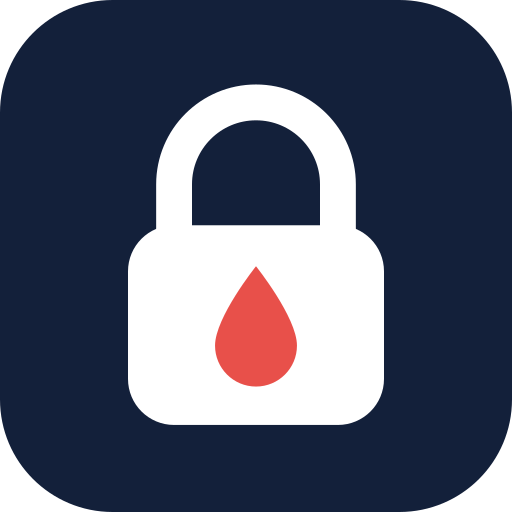

<p align="center"></p>

# Sugar Lock

See your CamAPS FX glucose on your lock screen, without unlocking your phone.

Sugar Lock reads the glucose that CamAPS FX already shows in its notification and puts it:

- **in a widget on your lock screen**, coloured by your target range
- **in the status bar**, as a small number at the top of the screen
- **in the lock-screen notifications**, with how old the reading is
- **in Samsung's Now Bar**, on One UI 8 phones that allow it

It only reads. It never changes anything in CamAPS, your pump or your sensor, and nothing leaves your phone.

> **Sugar Lock is a display only.** CamAPS FX stays in charge of your alarms and insulin. Always check CamAPS before acting on a number.

---

## 1. Install

1. On your phone, open the [latest release](https://github.com/LewisMcilreavy/Sugar-Lock/releases/latest).
2. Tap **SugarLock.apk** to download it.
3. Open the download and tap **Install**.
   - If Android blocks it, tap **Settings**, allow installs from your browser, go back and tap **Install**.
   - If Play Protect warns you, tap **More details > Install anyway**. It warns because the app isn't from the Play Store.

To update, do the same with a newer release. Your settings and widget are kept.

## 2. First-time setup

Open **Sugar Lock** and work down the screen:

1. **Allow notification access.** Switch on Sugar Lock in the list, and confirm. This lets it see the CamAPS notification.
2. **Allow this app to post notifications.** Tap **Allow**.
3. **Lock-screen settings.** Set lock-screen notifications to **Show content** (not "hide content").
4. **Battery.** Go to **Settings > Apps > Sugar Lock > Battery** and choose **Unrestricted**, so the phone doesn't put it to sleep.

Your first reading appears when CamAPS next updates, usually within 5 minutes. At the top of the app you should see:

- ✓ Notification access on
- ✓ Can post notifications
- Last reading … ago

## 3. Put the widget on your lock screen (Samsung)

Samsung only allows its own widgets on the lock screen, so this uses Samsung's free **Good Lock** app.

1. Install **Good Lock** from the Galaxy Store.
2. In Good Lock, install **LockStar** and switch it on.
3. Tap the lock-screen preview, then **Add widget**.
4. Choose **Sugar Lock > Glucose**, drag it where you want it and tap **Save**.

You can also add the same widget to your home screen: long-press the home screen, then **Widgets > Sugar Lock**.

## 4. Show it in the Now Bar (Samsung One UI 8)

1. Turn on Developer options: **Settings > About phone > Software information**, then tap **Build number** 7 times.
2. Go to **Settings > Developer options** and switch on **Live notifications for all apps**.
3. Open Sugar Lock once.

## 5. Set your target range

1. Open Sugar Lock and scroll to **Target range**.
2. Enter your low and high limits, in the same unit CamAPS uses. The default is 3.9–10.0 mmol/L.
3. Tap **Save**.

## 6. Reading the widget

```
15.8 ↘
mmol/L · 2 min ago
72% in range today
I count carbs so you don't have to.
```

The last line is a little diabetes joke. A random one is picked each day from about 150, and none repeats until they have all been shown.

**Colour**

| Colour | Meaning |
|---|---|
| Grey | In range, or no reading in the last 15 minutes |
| Amber | Above your range |
| Red | Below your range |

**Trend arrow**

The arrow is worked out from your readings over the last 5–20 minutes. It shows up about 10 minutes after the app starts.

| Arrow | Meaning |
|---|---|
| ⇈ | Rising fast |
| ↑ | Rising |
| ↗ | Rising slowly |
| → | Steady |
| ↘ | Falling slowly |
| ↓ | Falling |
| ⇊ | Falling fast |

This is the app's own calculation from the numbers. It can differ from the CamAPS arrow, so go by CamAPS.

**Old readings**

If no new reading arrives for 15 minutes:
- the widget goes grey
- the notification says **OLD READING**
- the status bar shows **?**

Check that CamAPS is running and connected to your sensor.

**Time in range today**

This is the share of today, since midnight, that your glucose was inside your target range. It shows once there's 30 minutes of data and resets at midnight. It only counts while the app is running, so it can differ slightly from CamAPS or Glooko.

## 7. Troubleshooting

| Problem | What to try |
|---|---|
| No reading appears | Check both ✓ marks in the app. Make sure CamAPS is showing its notification. Turn notification access off and on again. |
| Reading stops updating | Set Sugar Lock's battery use to **Unrestricted**. Restart the phone. |
| Number is wrong or missing | At the bottom of the app is **Last CamAPS notification text**. Send a screenshot of it so the reader can be fixed. |
| Widget is blank on the lock screen | Remove it in LockStar and add it again. |
| Nothing in the Now Bar | Check **Live notifications for all apps** is on in Developer options. Not every One UI version supports it. |

## Build it yourself

Every change pushed to this repo builds automatically with GitHub Actions and is published as a new release. To build locally, open the folder in Android Studio and press **Run**.

## Privacy

Sugar Lock has no internet access and keeps everything on your phone. See the [privacy policy](PRIVACY.md).

## Licence

Sugar Lock is open source under the [MIT licence](LICENSE). It is not made by or affiliated with CamDiab Ltd, and comes with no warranty: it is a display only and not a medical device.
